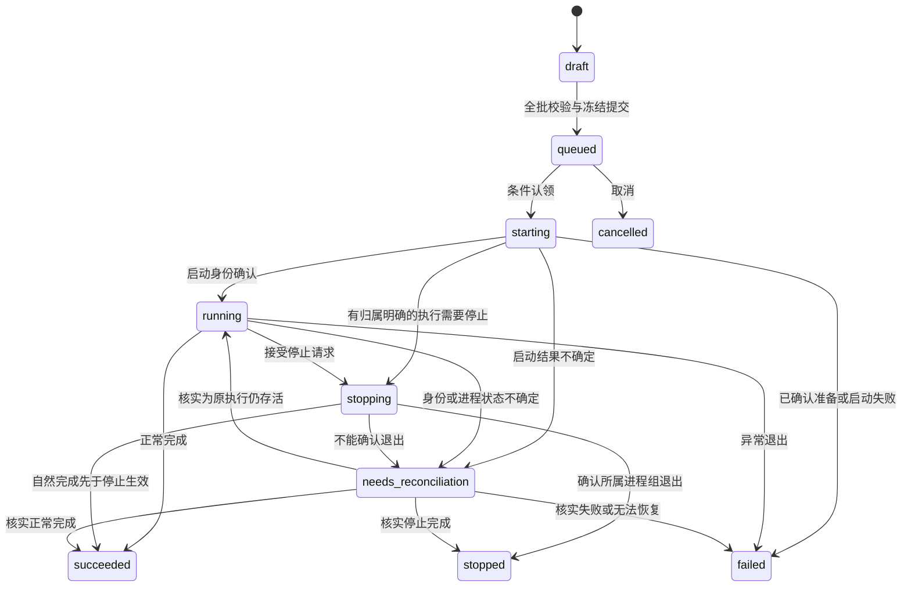

# Data Model: 业务记录、文档版本与查询投影

**Date**: 2026-10-23
**Spec**: [spec.md](spec.md)

## 对象与依赖边界

- API DTO 使用 Pydantic，领域和应用对象使用无框架依赖的类型，ORM 映射留在基础设施。
- 领域维护电池分配单元、划分合法性、实验输入冻结和状态转换；应用协调仓储与能力接口。
- JSON 文档是完整业务内容；SQLite 保存关系、状态和可重建查询投影；执行文件是带来源的导出。
- 时间使用 UTC，公共身份为应用生成 UUID。公开 DTO 不暴露文档物理路径、PID 或 ORM 状态。

## 关系与查询模型

| 记录 | 主要字段 | 约束与关系 |
| --- | --- | --- |
| DataSource | id、name、root_alias、revision、availability、created_at | root_alias 从部署允许列表选择，不接受任意绝对路径 |
| Battery | id、source_id、file_name、parent_battery_id、metadata、availability | unique(source_id,file_name)；派生样本沿父关系归为同一物理电池 |
| DocumentVersion | id、kind、owner_id、version、schema_version、sha256、storage_key、created_at | unique(kind,owner_id,version)；不可变、不能覆盖或删除被引用版本 |
| Split | id、name、source_id、head_document_id、revision | 同来源名称唯一；head 指向当前版本，不修改旧文档 |
| SplitMember | document_id、battery_id、partition、ordinal | 来源文档投影；unique(document_id,battery_id)；partition=train/val/test |
| Template | id、name、head_document_id、revision | 名称唯一；版本化配置；删除前检查引用 |
| Experiment | id、name、kind、state、revision、created_at、draft_document_id、frozen_document_id、split_document_id、source_split_document_id、target_split_document_id、checkpoint_id | kind=train/evaluate/transfer；一次实验一次执行；草稿引用可空，执行前必须齐备 |
| ExperimentQuery | experiment_id、source_id、split_id、model_type、task_type、requested_device、source_domain、target_domain、created_at | 从配置及引用生成，与 Experiment 和来源版本同事务更新 |
| Execution | experiment_id、intent_id、queue_order、queued_at、prepared_ref、receipt_ref、requested_device、effective_device、stop_requested_at、started_at、finished_at、exit_code、error | experiment_id 唯一且 1:1；不引入多次 Run；receipt_ref 为内部受控引用 |
| Component | id、provider_commit、scope、type、source_hash、origin、resource_ref | unique(provider_commit,scope,type)；origin=builtin/uploaded；目录描述属于可刷新查询结果 |
| Artifact | id、可空 experiment_id、origin、kind、relative_key、sha256、size、availability、component_id | origin=upload/execution；checkpoint_id 引用 Artifact.id；所有路径约束在允许资源根内 |
| Result | experiment_id、head_document_id、source_artifact_id、import_status、error | 与执行状态分开；任务成功不保证所有可选结果存在 |
| Metric | experiment_id、record_type、可空 source_document_id、source_artifact_id、generation、record_offset、epoch、stage、name、value、unit、granularity | record_type=epoch/final；stage=train/validation/test；JSONL 去重身份含来源/代次/位置 |
| IngestionCursor | experiment_id、artifact_kind、file_identity、byte_offset、source_hash、revision | 完整记录与游标同事务提交；文件替换不能盲用旧位置 |

Execution 是实验的执行信息和内部回执，不是可重复运行的独立业务资源。
ComparisonData、DifferenceResult、ChartSpec 默认按请求生成，不新增持久化聚合表。
当前 provider 的文件名映射为同一已登记 DataSource 下的 Battery，不能跨来源仅按文件名合并。

## 文档结构与冻结内容

统一 envelope：`schema_version=1`、`kind`、`owner_id`、`version`、`created_at`、`payload`。
sha256 对实际 UTF-8 序列化字节计算，放在 DocumentVersion；不自包含产生递归哈希。
同一提交重试复用事先生成的文档身份与版本，已有版本只允许内容完全相同的幂等确认。
物理文件按独立 DocumentVersion.id 命名，SQLite 约束逻辑 owner/version；
上次未提交的孤儿文件不会占住下一次合法操作的逻辑版本位置。

| kind | payload 内容 | 可变规则 |
| --- | --- | --- |
| split | dataset_name、source_id、train/val/test 的稳定 Battery ID 列表、method、seed、algorithm_version、parameters | 修改产生新版本 |
| template / experiment_draft | native_config 完整配置树、平台资源绑定、模板来源 | 草稿通过新版本编辑，API 不保留 YAML 排版和注释 |
| experiment_snapshot | native_config、划分版本、组件 source_hash、provider_commit、requested_device、seed、模板版本 | 提交后不可变 |
| result | metrics、predictions、warnings、source_hash、original（原始 epoch/单位/聚合说明） | 产物变化导入新版本，同一内容不重复产生版本；来源归档与头引用另由 SQL 关联 |

训练导出仅含 provider 支持的字段。划分导出严格为 `dataset/train/val/test`，成员转换为文件名，
不混入 envelope、平台 ID 或 schema_version。配置沿用 `mate/task` 及组件描述；执行清单另存
平台实验身份、来源版本、生成文件校验值及受控路径。

模板/草稿可保留尚未通过专业校验的配置，查询投影缺失字段为空。
执行前必须通过资源、设备、任务能力、provider 结构及构造接口校验。
明确设备允许 `cpu` 或 `cuda:N`（N 为非负整数），首版 `auto` 为 unsupported_device，
不得默认补设备或自动退回 CPU。

## 划分规则

- 划分输入以来源绑定的 Battery ID 表示；同一版本允许空分组，但任务可要求非空。
- 依据 parent_battery_id 追到物理电池根，禁止循环；同根派生样本不能跨分组。
- `shuffle-v1`：物理电池根按稳定 ID 排序，用保存的 seed 做局部随机打乱；
  按比例计算目标根数，先向下取整，再按小数余数从大到小分配余量，平局顺序 train/val/test。
- 混合划分固定已分配物理电池根，从各分组目标数中扣除；固定数超过目标即拒绝，剩余根再随机分配。
- 保存实际成员和生成算法版本；不能只保存种子并在将来运行时重新生成。
- 成员投影由同一版本文档生成；多个不同划分引用同一电池合法。

## 实验状态机

- draft 可编辑或删除。queued 起输入冻结；succeeded/failed/cancelled/stopped 为终态，只可复制新实验。
- 所有转换使用 revision 与预期状态条件更新，防止并发覆盖；运行完成先于停止时不得改记 stopped。
- needs_reconciliation 不能直接回 queued 或 starting。首版人工核对通过本机维护命令执行，
  必须验证运行清单、完整进程身份和产物证据，不提供可随意指定终态的公共 HTTP 接口。
- 批量入队在同一 SQLite 事务中保存快照引用和 queue_order；失败不部分接受新项。
  已活动项幂等返回；终态或不合法草稿使本批新项整体拒绝。
- 队列恢复只继续已确认从未认领的 queued 项；发现未核实活动执行时暂停派发。

## 查询索引与一致性

- Battery：来源+文件名唯一索引、source_id、parent_battery_id。可筛选 metadata 首版限已登记
  chemistry、material、temperature_c、nominal_capacity_ah，缺失为 null，不提供任意 JSON 查询。
- Experiment：state/created_at；ExperimentQuery：model_type/created_at、task_type/created_at、split_id/created_at、
  requested_device/created_at、source_domain/target_domain；具体联合索引通过查询计划验证，不重复建相同前缀索引。
- Execution：queued 队列按 queue_order、experiment_id 稳定排序；queue_order 由 SQLite 事务分配单调序号。
- SplitMember：document_id/partition/ordinal 及 battery_id；Metric：experiment_id/stage/epoch/name。
- 列表默认 created_at 降序、id 降序；队列按入队顺序。page 从 1 起、page_size 默认 50、上限 200。
  数据行与 total 在同一读事务中取得；全文内容按 document_id 读取，不逐个打开文档拼列表。
- 草稿编辑需 expected_revision；同一修订只有一个写入成功，冲突返回 conflict，调用方重新读取。
- 原文、查询投影及游标的来源版本可追溯；投影禁止单独编辑，可按已提交来源重建。

## 跨存储写入和恢复

1. 校验业务输入，生成不可变新文档，发布前检查现存版本冲突；文档发布操作受单写入锁保护。
2. 同目录临时写入，flush/fsync 后发布完整文件，必要时同步父目录；不覆盖已有版本。
3. 在单个 SQLite 事务内插入 DocumentVersion，更新业务引用、revision 和相关投影。
4. 文件失败则不提交引用；SQL 失败则原视图有效，新文件成为未引用对象。
5. 清理器只清理不被任何已提交版本引用、且超出一天保留窗口的完整孤儿文件；
   与发布/引用切换共享写锁并再次检查引用，不能删除在途或历史快照。
6. 外部删除/损坏属于显式存储错误：返回 storage_corrupt，保留引用与诊断，不静默重建成默认内容。

SQLite 业务事务与进程启动不具备原子性；启动前持久化 intent_id，prepare 回执先落盘及登记，
spawn 回执尽快原子发布。出现任何不确定窗口均进入待核实，不重发启动。

## 指标与产物导入

- JSONL 文件身份至少包括 inode/创建身份和导入代次；游标只跨过完整换行记录。
  去重键包含 experiment、导入代次、记录字节位置、stage、metric_name，与游标同事务提交。
- 文件替换或截断时创建新导入代次，保留旧来源证据；以新完整版本替换该来源的活动投影，避免合并旧尾部。
- best_result 按 sha256 幂等导入，记录原始窗口级指标与 `mean_by_battery` 预测分开。
- 仅已确认的 provider 指标有单位映射：mape=ratio，accuracy 实例对应的 acc 指标=percent；
  自定义指标以组件声明为准，否则 unknown。Unknown 不默认视为与另一实验单位兼容。
- Metric.value 和 prediction/target 必须是有限数或显式 null；不把 NaN/Infinity 写成标准 JSON 数值。
  无真值时不计算误差或置信区间，无指标文件时标记不可用，不改变已确认的执行终态。
- 权重按实际目录清单登记，不假定 checkpoint 下始终为 model.pth。

## 迁移约定

初次实现建立 Alembic 基线，临时文件 SQLite 验证升级、约束、数据保留和重启。
未来 MongoDB 实现复用 DocumentStore 契约：保持文档身份、版本、哈希及 payload 语义，
显式导入、验证引用与数量、切换、保留回退，不长期双写。
