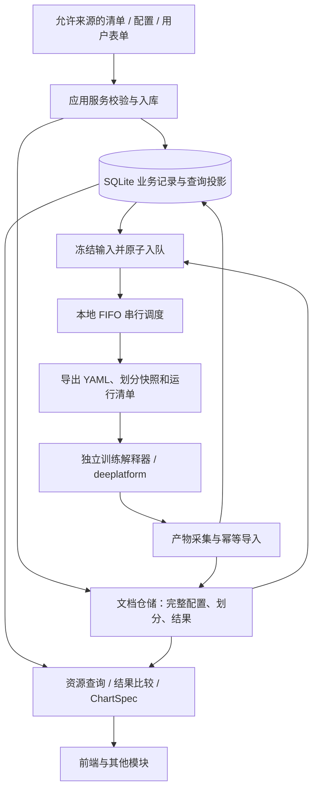

# Implementation Plan: 电池实验平台后端首版业务

**Branch**: `001-backend-experiment-platform` | **Date**: 2026-10-23 | **Spec**: [spec.md](spec.md)

**Input**: Feature specification from `/specs/001-backend-experiment-platform/spec.md`

## Summary

建立以数据存取和查询为中心的模块化单体后端。业务数据先保存，执行时从冻结快照生成训练输入，
结果按来源版本导入并建立查询投影。训练使用固定 deeplatform 提交，主项目提供可替换的
FIFO 串行调度、基础集合分析和 ChartSpec 构建。首版不接受 `auto`，不修改训练子模块。

本文件及配套文档是实现依据；当前阶段交付规格和设计，应用实现、迁移和 TDD 执行由后续任务承载。

## Technical Context

**Language/Version**: 主项目 Python >=3.14（沿用 pyproject.toml）；训练解释器独立配置，必须与 provider 依赖兼容。

**Primary Dependencies**: FastAPI、Pydantic、SQLAlchemy 2.x、Alembic、PyYAML、Uvicorn；开发检查使用 pytest、HTTPX、Ruff、ty。实际解析版本保存在 uv.lock，训练依赖不加入 API 包。

**Storage**: SQLite 文件库 + 同步 ORM；JSON 不可变文档版本；文件系统保存日志、原始电池及模型产物。MongoDB 仅为未来文档仓储替换目标。

**Testing**: 领域和用例单元测试、临时文件 SQLite/JSON 集成测试、API/能力契约测试、受控短进程生命周期测试、独立训练环境冒烟。

**Target Platform**: Linux/POSIX、本机或受控内网、一个 API 进程；默认绑定 127.0.0.1。训练环境和可访问数据单独配置。

**Project Type**: 前后端分离 Web 后端；本功能不构建前端页面。

**Performance Goals**: 1,001 条电池记录、23 份划分、100 条实验的固定基准下，单用户常用检索 p95 <=2s；不含训练、分析和大文件传输。实测证据见 quickstart.md。

**Constraints**: 不引入 Redis/任务队列服务；一次实验一次执行；明确设备；文档仓储单进程写；真实训练缺口不以模拟数据掩盖。

**Scale/Scope**: FR-001 至 FR-034，7 个用户故事；常用业务字段检索，不提供任意超参数查询 DSL。

## Constitution Check

*GATE: Must pass before Phase 0 research. Re-check after Phase 1 design.*

| 门槛 | 设计前 | 设计后证据 |
| --- | --- | --- |
| 宪章与范围 | PASS：依据 2.0.0 及用户明确分工 | spec.md 的 Assumptions 与本文件 Summary |
| 前后端与训练隔离 | PASS：独立 API、独立训练解释器 | contracts/capabilities.md 的桥接与进程协议 |
| 轻量 DDD | PASS：API → 应用 → 领域/接口；基础设施实现接口 | Project Structure 与 data-model.md 的对象边界 |
| ORM/文档职责 | PASS：关系查询由 ORM，完整文档经仓储 | data-model.md 的权威数据、索引和提交顺序 |
| 实验与设备 | PASS：一次执行，拒绝 auto，显式设备不变 | 状态机、队列事务、执行输入契约 |
| 基础功能真实性 | PASS：本地基础实现使用真实数据 | 能力版本、支持矩阵和 ChartSpec |
| SDD/TDD | PASS：验收条件先行，实施需红绿重构 | quickstart.md 的验收矩阵与 FR 对应 |
| 复杂度 | PASS：无新增常驻服务和分布式事务 | research.md 的替代方案分析 |

以上 PASS 表示设计符合宪章，不代表应用代码或真实 GPU 联调已经通过。

## Project Structure

### Documentation (this feature)

```text
specs/001-backend-experiment-platform/
├── spec.md
├── checklists/requirements.md
├── plan.md
├── research.md
├── data-model.md
├── contracts/
│   ├── http-api.md
│   ├── openapi.json
│   └── capabilities.md
└── quickstart.md
```

后续 tasks.md 由任务分解阶段生成，不将未实施任务标记完成。

### Source Code (repository root)

以下为计划目录，当前不创建空应用框架：

```text
src/batteryland/
├── main.py                   # 应用/CLI 装配与启动
├── interfaces/api/           # Router、Pydantic DTO、异常与流协议
├── application/              # 资源、配置、实验、采集及比较用例
│   └── ports/               # 仓储、训练、调度、分析与图表窄接口
├── domain/                   # 划分规则、实验状态、领域对象与错误
└── infrastructure/
    ├── persistence/          # ORM 映射、Session、查询投影和事务实现
    ├── documents/            # JsonDocumentStore
    ├── training/             # deeplatform 适配器及独立解释器桥接
    ├── scheduling/           # LocalSerialScheduler
    └── analysis/             # BasicDifferenceAnalyzer / BasicChartBuilder
src/batteryland/infrastructure/persistence/migrations/ # 随包分发的 Alembic 迁移
tests/
├── unit/
├── integration/
└── contract/
src/deeplatform/               # 保留既有子模块，固定提交
```

**Structure Decision**: 保留主项目包位置；按真实职责分层，应用内部围绕业务命名。
不建立通用 Repository 基类、事件总线或每张表一个领域服务。前端单独维护。

## Workflow and Data Flow



### 保存、查询与版本

- 显式导入清单、划分和模板；重复导入按来源身份和内容哈希去重，不设置启动全目录自动同步。
- SQLite 存 ID、关系、状态、队列和文件引用。完整配置、划分成员和结果在版本化文档中；
  模型/任务/设备/数据集/源目标域、成员及指标是可重建查询投影，与来源版本一起提交。
- 每次用例在同一个同步工作线程内创建、使用和关闭 Session；路由和后台采集不共享 Session。
  事务仅包住数据库操作，不跨越训练、进程启动或大文件读取。
- 查询只选择摘要及需要字段，按固定字段过滤和稳定分页；读取详情才加载对应文档。
- 文档先发布不可变版本，再在 SQLite 单事务中切换引用、索引及业务修订号。
  发布失败不提交数据库；数据库失败保留旧引用，清理未引用文件。详见 data-model.md。

### 实验与串行调度

- 草稿可修改；批量提交先检查全部新实验，固定版本和组件源码身份后在一个事务中入队。
  任一新项失败则不接收本批新项；已活动项返回已有状态，不重复创建执行。
- API lifespan 启动一个协调循环。其同步调度用例自行管理 Session，持久化条件认领
  `queued → starting` 后结束事务，再调用训练适配器；始终最多一个活动执行。
- 先通过桥接 prepare 取得目录并登记，再由后端使用训练解释器直接启动
  `main.py --experiment-dir`，使用独立进程组并保存结构化回执。不解析中文启动提示。
- 后端自建基础调度器执行 FIFO、排队取消和所属进程组终止；不实现 GPU 选择、并行调度或恢复训练。
- 停止先标记 stopping，核验执行身份后发 SIGINT，10s 后仍存活则 SIGTERM，再等 5s 后 SIGKILL。
  必须确认所属进程组退出才写 stopped；不能证明身份或退出则 needs_reconciliation。
- 启动进程与保存回执不是原子事务。不确定时暂停新增派发，不自动再次启动；
  重启先核对，未启动的 queued 项可继续，终态项重跑必须复制新实验。

### 产物采集与展示

- 指标完整行分批导入；在同一事务中更新记录及读取游标。日志保留文件，按游标读取或 SSE 转发。
- 结果按文件身份与内容哈希导入版本；保留原文件来源证据、单位和粒度，指标索引可重建。
- 指标单位已确认：当前 provider 的 MAPE 为比率、Accuracy 为百分数；其他自定义指标无声明则 unknown。
  不从指标拼写猜单位，不用逐电池均值预测重算覆盖窗口级指标。
- 结果比较输出指标/电池并集；基础分析只算集合关系和已登记分类，ChartSpec 构建不生成可执行脚本。

### 训练接入门槛

- 固定 provider 提交 `6b4c76d6e639ddaf9db9c15bf04771179a68d988`；组件目录和上传复用现有工具。
  上传到后端运行目录，并在单写入锁内合并内置与上传目录的静态声明查重。
- 当前 datafactory 未传入 split_dir 且数据来源路径固定。内置划分仅在快照成员完全一致、数据可读时可执行；
  自定义划分仅能完成管理和导出，真实执行返回明确不满足条件，等待维护者补接口。
- datafactory.root_path 指向本实验的受管数据工作区，复制所需标签输入，供 provider 写合并标签及 data 软链接；
  不向只读子模块写运行数据，不通过此工作区改变固定原始数据来源。
- 当前状态文件的 device 是请求值，不是真实设备回报。适配器保留 requested_device，
  effective_device 未经运行环境确认时为空；不重编号或静默换设备。独立评估和迁移任务也需能力就绪。
- 真实接入缺口不阻止其他后端用例的契约验收，但不能将对应真实流程标为全部完成。

## Delivery and Validation

1. 根据 spec.md 和 contracts/ 分解 tasks.md，每个行为任务先安排可观察的失败测试。
2. 先完成持久化、迁移、资源与配置，再完成实验状态、输入导出和受控进程串行闭环。
3. 接入目录/上传及可用训练能力，最后完成增量采集、比较、基础分析和 ChartSpec。
4. 按 quickstart.md 执行场景、格式/类型检查与查询基准；真实训练联调单独报告环境及结果。

实现与验收已经执行；测试、查询基准、HTTP 冒烟、打包及真实训练缺口见 quickstart.md。

## Complexity Tracking

无需要豁免的宪章违反项。文档仓储接口对应 MongoDB 替换边界，训练及三类能力接口对应已确认的所有权边界。
